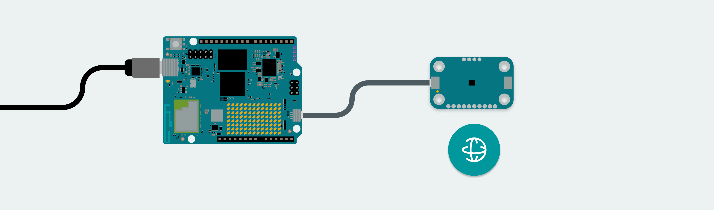
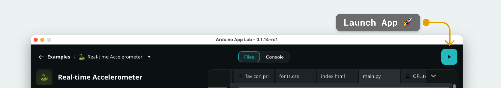
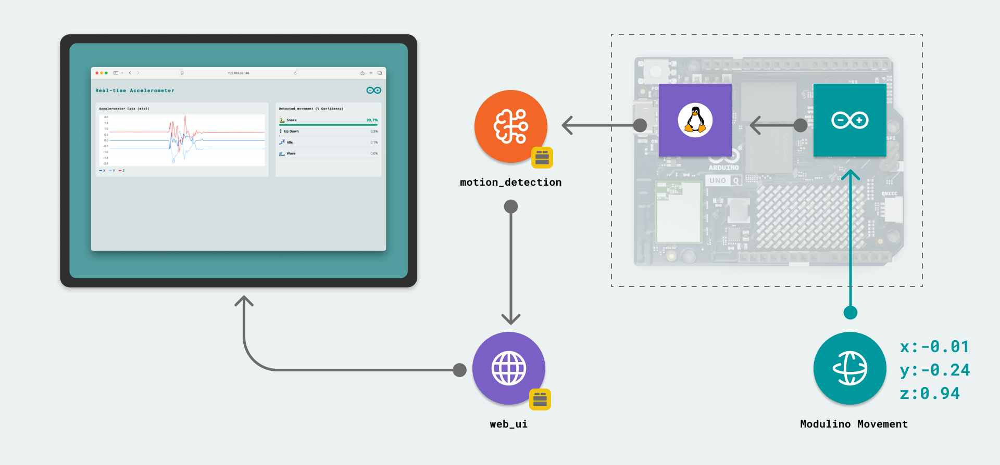

# Racing Telemetry Workshop 🏎️

Build an F1-style steering wheel with an Arduino UNO Q. It uses edge AI to recognise motion and shows live telemetry.

Modulino Movement streams raw accelerometer data, and an Edge Impulse model classifies it as **idle**, **steering** or **gearchange**. The results drive a race display on the UNO Q LED matrix and the Modulino Pixels, and a live web dashboard.

- Steering and gear-change gestures are detected in real time.
- Modulino Buttons handle the engine, revs and downshifts.
- A live web dashboard shows telemetry, state and motion confidence.
- The LED matrix and Modulino Pixels work as an on-wheel race display: rev bar, shift prompt, steering cues and gear indicator.

📽️ **Workshop slides:** [Racing Telemetry Workshop slides](https://docs.google.com/presentation/d/1UUZPUZ8j5eCHwoCa3FpvcXehR45ZjA4e6LxxbTRHuOk/edit?usp=sharing)



---

## Contents

- [Bill of Materials](#bill-of-materials)
- [Making the Wheel Board](#making-the-wheel-board)
- [Assembling the Wheel](#assembling-the-wheel)
- [Loading the App with App Lab](#loading-the-app-with-app-lab)
- [Using Your Own Edge Impulse Model](#using-your-own-edge-impulse-model)
- [Using the Wheel](#using-the-wheel)
- [How It Works](#how-it-works)
- [Understanding the Code](#understanding-the-code)

---

## Bill of Materials

| Qty | Part | Notes |
| --- | --- | --- |
| 1 | [Arduino UNO Q](https://store.arduino.cc/products/uno-q) | Main board (MCU + Linux) |
| 1 | [Arduino Modulino Movement](https://store.arduino.cc/products/modulino-movement) | Accelerometer for steering and gear-change detection |
| 1 | [Arduino Modulino Buttons](https://store.arduino.cc/products/modulino-buttons) | Engine, downshift and throttle buttons |
| 1 | [Arduino Modulino Pixels](https://store.arduino.cc/products/modulino-pixels) | Rev / shift lights |
| 3 | Qwiic cables | The ones included with the Modulinos |
| 16 | [Snap-fit PCB spacers (RS 030-4178)](https://uk.rs-online.com/web/p/pcb-spacers/0304178) | 4 for the UNO Q + 4 for each Modulino |
| 1 | Wheel board | Order the PCB, 3D print it, laser cut it or make it from cardboard (see below) |
| 1 | USB-C cable | To connect the UNO Q to your computer |

### 3D-printed jigs (essential)

| File | Purpose |
| --- | --- |
| [`spacer-jig.3mf`](hardware/jigs/spacer-jig.3mf) | Main board jig: holds the wheel board while you push in the spacers. Print at **80% infill**. |
| [`uno-q-jig.3mf`](hardware/jigs/uno-q-jig.3mf) | Presses the UNO Q evenly onto its spacers |
| [`modulino-jig.3mf`](hardware/jigs/modulino-jig.3mf) | Presses each Modulino evenly onto its spacers |

---

## Making the Wheel Board

Pick one of these options.

### Option 1: Order a PCB (recommended)

[`wheel-pcb-gerbers.zip`](hardware/pcb/wheel-pcb-gerbers.zip) holds the Gerber and drill files for the wheel.

1. Go to [JLCPCB](https://jlcpcb.com/) and click **Instant Quote / Order now**.
2. Upload `wheel-pcb-gerbers.zip` as it is. Don't unzip it.
3. Keep the default settings, or pick a solder mask colour you like.
4. Leave PCB Assembly **off**.

> **Note:** The board has **no components, copper traces or electrical connections. This is intentional.** The PCB is only a rigid, good-looking mechanical base for the UNO Q and Modulinos, and the parts connect to each other with Qwiic cables. If the JLCPCB preview shows only the outline, silkscreen and mounting holes, that's correct.

### Option 2: 3D print

Print [`wheel-board.3mf`](hardware/3d-print/wheel-board.3mf) on any FDM printer.

### Option 3: Laser cut or cardboard

The board is a flat plate with mounting holes, so you can laser cut it from acrylic or plywood, or cut it by hand from stiff cardboard.

- [`wheel-board.dxf`](hardware/laser-cut/wheel-board.dxf): for laser cutters and CAD (units: mm)
- [`wheel-board.svg`](hardware/laser-cut/wheel-board.svg): for Inkscape, LightBurn, or printing at 100% scale as a cardboard template

Both are taken directly from the PCB outline: a 171.7 × 97.9 mm board with 3.2 mm holes for the spacers. Do a test cut first to check the spacers snap into the holes in your material. They're designed for a 1.6 mm PCB, so a much thicker material may not work.

> There are 20 holes but you only need 16 spacers. The board has four Modulino spots, and this build uses three of them.

---

## Assembling the Wheel

> ⚠️ **Use the jigs.** The UNO Q can **bend and break** if you press it onto the spacers by hand. The jigs spread the force evenly across the board.

1. **Fit the spacers to the wheel board.**
   Put the wheel board in the **spacer jig** (`spacer-jig.3mf`) with the **logo side facing up**. From the logo side, push a snap-fit spacer into each of the 16 holes you'll use until it clicks: the 4 UNO Q holes in the centre, and the 4 holes of each of the three Modulino spots.

2. **Mount the UNO Q.**
   Place the UNO Q over the spacers in the **centre** of the board. Use the **UNO Q jig** to press it straight down until all the spacers click into place. Don't press the UNO Q by hand.

3. **Mount the Modulinos.**
   Place Modulino Movement, Modulino Buttons and Modulino Pixels over three of the Modulino spots on the board. Use the **Modulino jig** to press each one onto its spacers.

4. **Connect the Qwiic cables.**
   Daisy-chain the boards with the three Qwiic cables that came with the Modulinos: UNO Q → first Modulino → second Modulino → third Modulino. The order along the chain doesn't matter, because each Modulino has its own I²C address.

5. Plug the UNO Q into your computer with a USB-C cable.

---

## Loading the App with App Lab

1. Download this project as a ZIP. On GitHub, click **Code → Download ZIP**. Don't unzip it.
2. Open **Arduino App Lab** and connect to your UNO Q.
3. **Drag and drop the ZIP** into App Lab to import it. It appears under **My Apps** as **Racing Telemetry Workshop**.
4. Open the app and click **Run**. App Lab builds the sketch, flashes the MCU and starts the Python side.
5. When the app is running, open the dashboard at `http://<BOARD-IP>:7000` in a browser on the same network.



> Only one app runs on the board at a time. Starting this app stops any app that's already running.

---

## Using Your Own Edge Impulse Model

The app ships with a pre-trained model at `python/model.eim`. To use your own, replace that file:

1. **Train the model in Edge Impulse.** Use the same three class labels, `idle`, `steering` and `gearchange`, because the app listens for those names. Use 3-axis accelerometer data sampled at **62.5 Hz**, the rate the sketch streams at (`sensorInterval = 16` ms). The values arrive in m/s².
2. **Deploy it for the UNO Q.** In your Edge Impulse project, go to **Deployment**, choose **Arduino UNO Q**, and build. This downloads a `.eim` file.
3. **Rename the file to `model.eim`.**
4. **Upload it to the app.** In App Lab, open the app's files, go to the `python/` folder, and upload your `model.eim` to replace the existing one.
5. **Run the app again.**

> Don't select a model in the Motion Detection brick's settings. This app always loads `python/model.eim`, so a model picked there is ignored.

To switch back, replace `python/model.eim` with the one from this repository.

---

## Using the Wheel

| Button | Action |
| --- | --- |
| **A** | Toggle the engine on/off |
| **B** | Downshift |
| **C** | Hold to throttle up and build revs |

1. Start with the engine off and look at the idle display.
2. Press **A** to start the engine.
3. Hold **C** to build revs until the redline shift prompt flashes.
4. Make the gear-change gesture with the wheel to **upshift**. The AI model detects it. Press **B** to downshift.
5. Turn the wheel to steer, and watch the classification confidence on the dashboard.
6. See how the AI output drives the LED matrix and the rev lights on the Pixels.



---

## How It Works

This workshop extends the **Real-time Accelerometer Data** App Lab example: sensor streaming, edge inference and a Web UI. It adds four things:

1. **Driving-specific classes:** the model is trained on `idle`, `steering` and `gearchange`.
2. **A bidirectional control loop:** telemetry flows from the MCU to Python, and the interpreted state flows back to the MCU so the displays react immediately.
3. **Runtime calibration:** you can adjust the steering angle offset and inversion while the app runs, and the settings are saved.
4. **A race HMI:** the web page and LEDs turn raw inference into feedback for the driver.

**On the MCU:**
- Modulino Movement provides raw `x`, `y`, `z` acceleration, which is sent to Python over Bridge (`record_sensor_movement`).
- The LED matrix shows steering cues, the gear, revs and redline shift prompts.
- Modulino Buttons handle the engine, downshift and throttle. Modulino Pixels show the rev lights.

**On the Linux (Python) side:**
- Samples are buffered and passed to the `motion_detection` Brick.
- The inference output is converted into telemetry state and broadcast to the Web UI.
- Motion hints are sent back to the MCU (`ml_state_update`, `ml_gear_up`) for low-latency display updates.

### Bricks used

- `motion_detection`: runs edge inference on the streamed movement samples.
- `web_ui`: serves the dashboard and the telemetry APIs and messages.

### AI model

An Edge Impulse motion-classification model, based on [Motion Classification – Continuous Motion Recognition](https://studio.edgeimpulse.com/public/497631/latest). The model file is in `python/`, and `app.yaml` points to it.

---

## Understanding the Code

### Linux (Python): `python/main.py`

- `MotionDetection(confidence=CONFIDENCE)` initialises edge inference.
- `record_sensor_movement(x, y, z)` receives MCU samples, buffers them and calculates steering angle and direction hints.
- `on_movement_detected(classification)` normalises the model output, picks the dominant state and pushes updates to the UI and the MCU.
- `Bridge.notify("ml_state_update", ...)` and `Bridge.notify("ml_gear_up")` send the interpreted motion events back to the sketch.
- `web_ui.expose_api("GET", "/detection", ...)` and `web_ui.expose_api("GET", "/config", ...)` expose the motion and calibration state.
- `on_angle_calibration(...)` saves the steering calibration to `runtime_config.json`.

### Microcontroller: `sketch/sketch.ino`

- `Bridge.notify("record_sensor_movement", x, y, z)` streams accelerometer data to Python.
- `Bridge.provide("ml_state_update", ...)` receives steering and idle hints.
- `Bridge.provide("ml_gear_up", ...)` receives upshift events triggered by the AI.
- The LED matrix rendering combines local timing with the AI hints for the steering arrows, gear display, rev bar and redline flash.
- Modulino Pixels mirror the rev segments as shift lights.

---

## Repository Layout

```
app.yaml                       App Lab app definition (bricks, model path)
sketch/                        MCU sketch (Arduino, Zephyr)
python/                        Linux side: main.py + Edge Impulse model (model.eim)
assets/                        Web dashboard (HTML/CSS/JS) and docs images
hardware/
  pcb/wheel-pcb-gerbers.zip    Wheel board Gerbers for JLCPCB (no components, on purpose)
  3d-print/wheel-board.3mf     3D-printable wheel board
  laser-cut/wheel-board.dxf    Laser-cut outline (mm)
  laser-cut/wheel-board.svg    Laser-cut outline / cardboard template (mm)
  jigs/spacer-jig.3mf          Holds the board while you push in the spacers (print at 80% infill)
  jigs/uno-q-jig.3mf           Presses the UNO Q onto its spacers
  jigs/modulino-jig.3mf        Presses each Modulino onto its spacers
```
